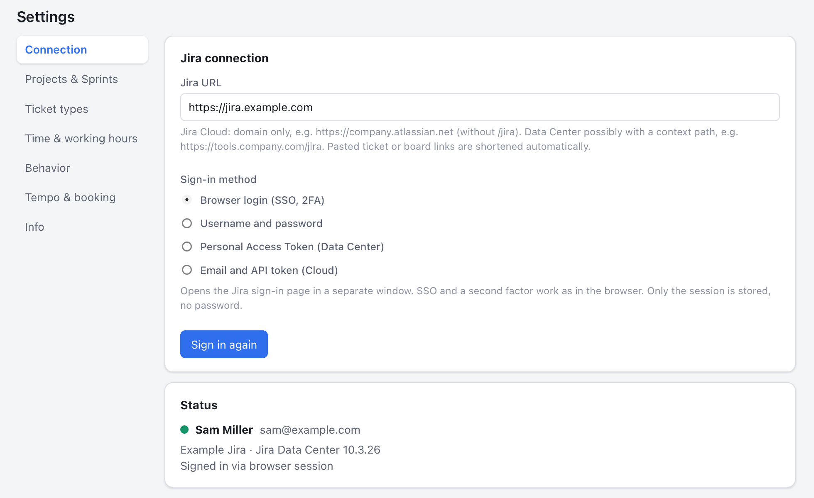
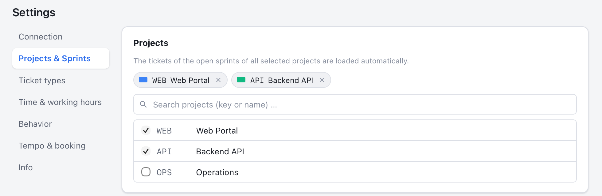
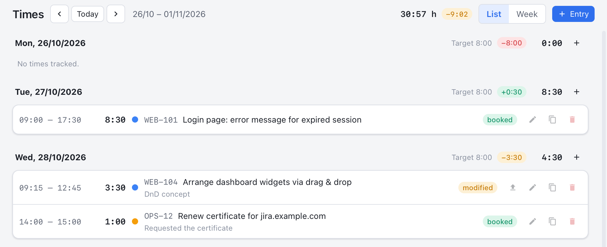
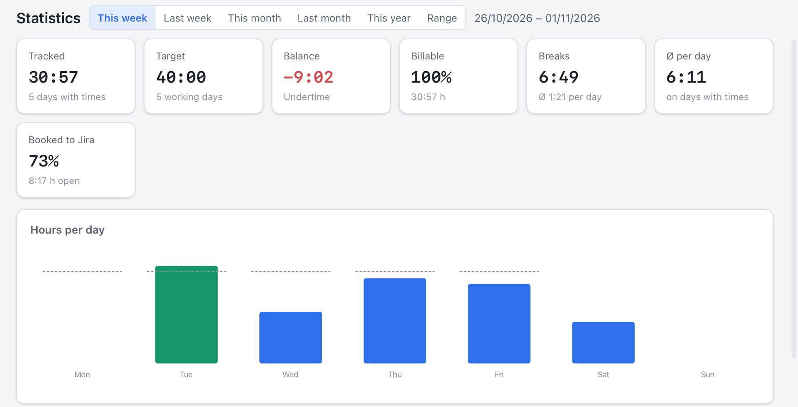

# YaTTT – Yet another Time Tracking Tool

Desktop time tracking on Jira tickets for macOS, Windows and Linux. Projects and tasks come
exclusively from Jira, times are stored locally and booked as worklogs to Jira or Tempo.
The feature set follows [Tyme](https://www.tyme-app.com/en/). The interface is available in
English and German.

Written in Rust (Tauri 2, business logic in the `yattt-core` crate) with a Svelte UI.

<p align="center">
  
</p>
<p align="center">
  
  
</p>

<sub>The app screenshots show the sample data of the browser mock; the menu bar menu is a
recreation built from the real menu entries.</sub>

## Features

- **Timer** per ticket: start/stop in the ticket list, the timer bar, the tray menu and via a
  global shortcut. The start time can be adjusted afterwards, the note becomes the worklog
  comment. Optionally several timers at once.
- **Tickets from Jira**: choose projects and sprints with search; the tickets of the open
  sprints of all selected projects are always loaded. Ticket types (e.g. epics) can be hidden.
  Automatic refresh at a configurable interval plus manual refresh. Subtasks appear under their
  parent, favorites on top, target/actual bars from the estimate. Components and labels are
  shown and can be used as filters.
- **Favorites** (up to 15) appear in the tray/menu bar menu and can be started and stopped
  there with a click; a check mark shows the running timer.
- **Filter per project** for projects shared by several teams: components and/or labels can be
  configured per project, then only matching tickets are loaded ("component and label" or
  "component or label").
- **Times**: day list and week timeline, create, edit, duplicate and delete entries (with
  undo), target/actual per day, booking status per entry.
- **Booking to Jira/Tempo**: as a Jira worklog, via the Tempo Timesheets API (Data Center) or
  the Tempo Cloud API. Changes and deletions are propagated, errors stay visible and are
  retried. Optional rounding when booking and booking right when the timer stops.
- **Statistics**: tracked/target/balance, billable share, breaks, hours per day/week,
  distribution by project, top tickets, activity heatmap of the last twelve months.
- **Export**: CSV, JSON, printable timesheet (start, end, breaks, worked time, target/actual) as PDF.
- **Reminders**: no timer after the start of the workday, daily goal reached, break, timer
  running for a long time, unbooked times.
- **Idle and sleep**: after a configurable idle period or after waking up, the app asks whether
  to keep the time, subtract it or stop the timer retroactively.
- **Shutdown, restart, quit with a running timer**: prompt "stop or keep running" (native on
  macOS, on Windows via a shutdown block with a dialog in the app). A heartbeat additionally
  saves the state so that after a crash or shutdown the app asks at the next start what to do
  with the timer that was still running.
- **Stored locally**: SQLite database in the user data directory, daily backups, credentials
  encrypted with a key in the operating system keychain.
- **Language**: English or German, following the system by default and switchable in the
  settings; applies to the UI, the tray menu, notifications and messages.
- Tray/menu bar icon with the running time, autostart, light/dark mode.

## Signing in to Jira (SSO, second factor, no API token)

The default is the **browser login**: the app opens the Jira sign-in page in its own window.
SSO redirects and a second factor work as in the browser. Afterwards the app takes over the
session; a password is never stored. Alternatives: username and password (Data Center without
SSO), Personal Access Token (Data Center) or email and API token (Cloud). Details, test log and
checklist: [docs/JIRA_AUTH.md](docs/JIRA_AUTH.md).

## Installation

Ready-made packages are attached to the [GitHub releases](../../releases): `.dmg` (macOS),
`.msi`/`-setup.exe` (Windows), `.deb`/`.rpm`/`.AppImage` (Linux). Without code signing, macOS
shows a warning on first launch: right-click → Open or `xattr -dr com.apple.quarantine /Applications/YaTTT.app`.

Linux needs WebKitGTK 4.1 and a tray-capable desktop (on GNOME possibly the AppIndicator extension).

## Quick guide

### 1️⃣ Connect

**Settings → Connection:** enter the Jira URL (for Jira Cloud just `https://company.atlassian.net`),
keep "Browser login", **Sign in**. In the login window you sign in as usual, with SSO and a
second factor. No API token, no stored password.



### 2️⃣ Choose projects

**Settings → Projects & Sprints:** search for projects and tick them. From now on the tickets of
the open sprints are loaded automatically and refreshed regularly. Under **Ticket types**, epics
are hidden by default.



### 3️⃣ See only your team *(optional)*

Several teams working in one project? **Filter per project:** enter a component and/or label,
the project's component list is offered as suggestions. Only matching tickets are loaded, all
other projects stay untouched.


### 4️⃣ Start a timer

**Tickets:** ▶ starts the timer on a ticket, ■ stops it. The running timer sits at the top in the
bar and with its time in the menu bar. ⭐ makes a ticket a favorite for the tray menu. Chips for
components and labels filter the list with a click.


### 5️⃣ Track straight from the menu bar

The window can stay closed: the **tray icon** shows the running time and the ticket. The menu
lists the running timer with **Stop timer**, below it the **favorites**: one click starts the timer
for that ticket, a click on the running one (✓) stops it. Recently used tickets follow with ▶.
Up to 15 favorites, marked with ⭐ in the ticket list.


### 6️⃣ Check and book times

**Times:** day list with target/actual, adjust or add entries, then **Book week**. Every entry
shows its state: *local*, *booked*, *modified* or *Error*. Booked entries are updated in Jira when
they change.



### 7️⃣ Keep an overview

**Statistics:** tracked, target and balance, hours per day, distribution by project, top tickets.
Export as CSV, JSON or a printable timesheet.



> 💡 **Jira Cloud with Tempo:** under *Tempo & booking* choose the Tempo Cloud API so that
> bookings appear in Tempo immediately. Tempo Cloud only picks up Jira worklogs overnight.
>
> 🔌 **Shutting down with a running timer?** YaTTT pauses briefly and asks: stop or keep running.
> After a crash the app asks at the next start.
>
> 🌐 **Language:** *Behavior → Language* switches between English and German; the default
> follows the operating system.

## Development

Prerequisites: Rust (stable), Node.js 20+, platform-specific
[Tauri prerequisites](https://tauri.app/start/prerequisites/).

```bash
npm install
```

```bash
npm run tauri dev
```

The UI can also be developed in a browser without Tauri (mock backend with sample data):

```bash
npm run dev
```

In the mock, `?view=times|stats|settings`, `?tab=selection` and `?lang=de|en` open a view directly
in a given language. The screenshots in `docs/screenshots/` are generated from it with
`scripts/screenshots.sh` (macOS, WebKit snapshot at Retina resolution); the menu bar image is
rendered from `scripts/tray-mockup.html`.

UI texts live in `src/lib/locales/de.ts` and `en.ts`; texts produced by the Rust side (tray
menu, notifications, error messages, CSV headers) use the `tr!("Deutsch", "English")` macro of
`yattt-core`.

Tests and checks:

```bash
cargo test -p yattt-core
```

```bash
npm run check
```

Release build:

```bash
npm run tauri build
```

## Project structure

```
crates/yattt-core   Business logic without Tauri: Jira/Tempo client, SQLite, timer, statistics, export, secrets, i18n
src-tauri           Tauri app: commands, tray, login window, scheduler, shutdown hooks
src                 Svelte frontend (views, components, mock backend, locales)
docs                Plan, review, Tyme analysis, Jira auth, architecture, release
.github/workflows   CI (tests on three platforms) and release (tauri-action)
```

Further documentation: [Plan](docs/PLAN.md), [Review](docs/PLAN_REVIEW.md),
[Tyme analysis](docs/TYME_ANALYSIS.md), [Architecture](docs/ARCHITECTURE.md),
[Release](docs/RELEASE.md).

## Data locations

| What | macOS | Windows | Linux |
|---|---|---|---|
| Settings, encrypted credentials | `~/Library/Application Support/YaTTT` | `%APPDATA%\YaTTT` | `~/.config/YaTTT` |
| Database, backups, logs | `~/Library/Application Support/YaTTT` | `%APPDATA%\YaTTT` | `~/.local/share/YaTTT` |

## License

MIT
