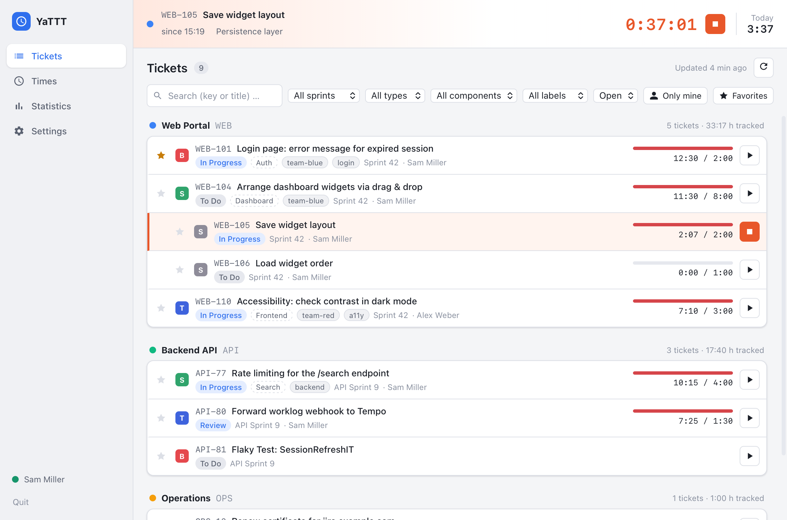
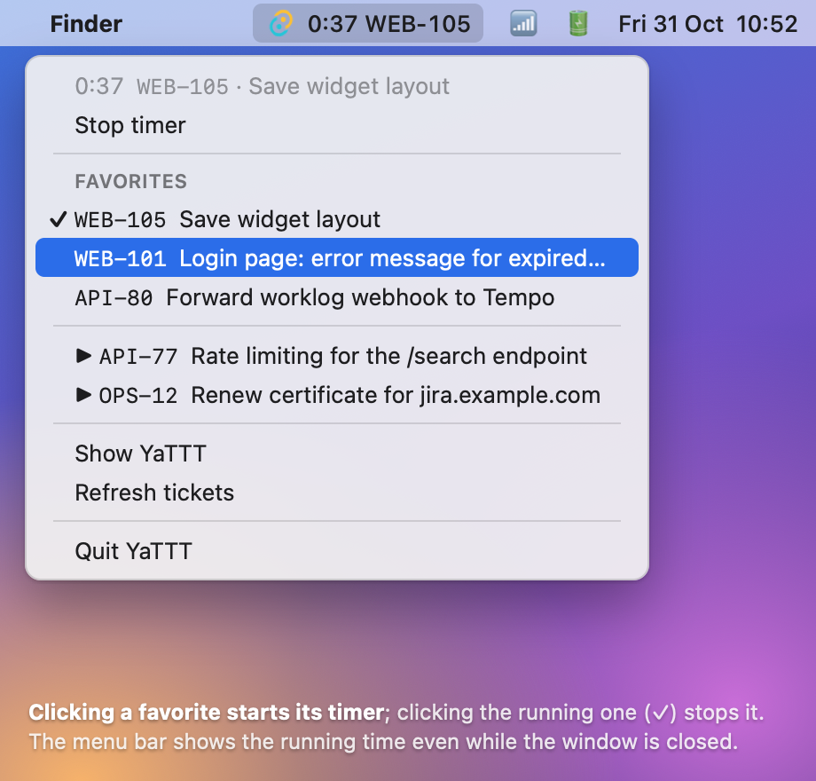
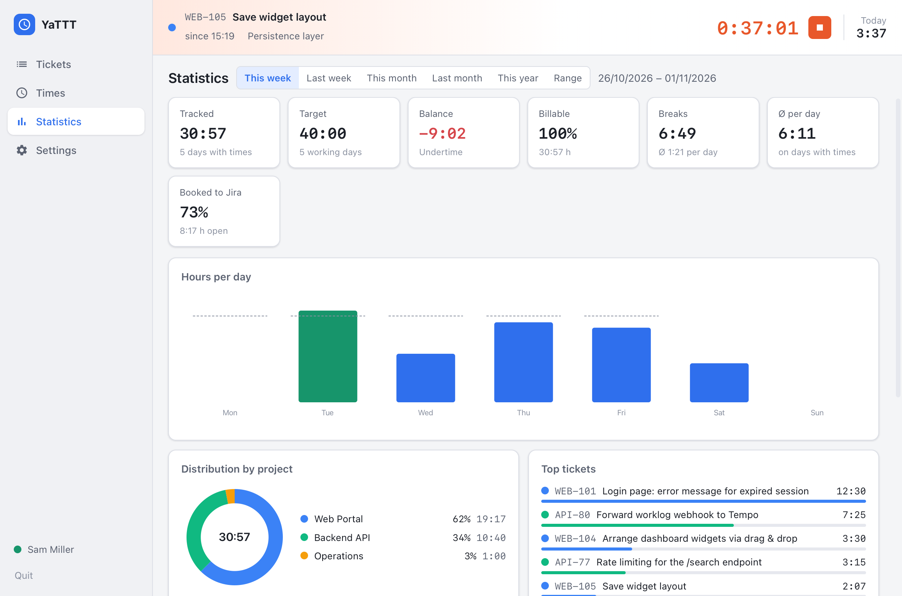
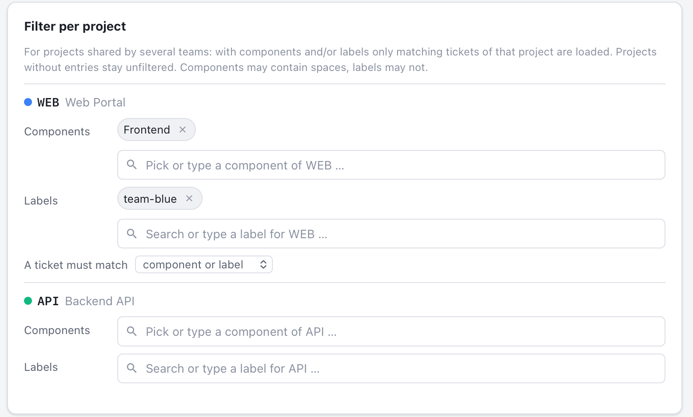
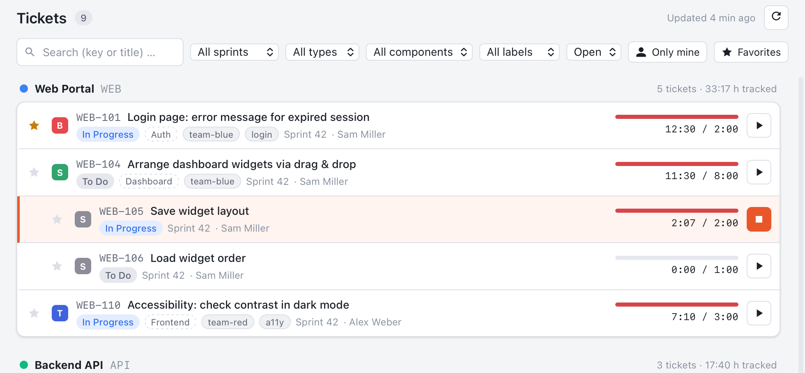

# YaTTT – Yet another Time Tracking Tool

Desktop-Zeiterfassung an Jira-Tickets für macOS, Windows und Linux. Projekte und Aufgaben kommen
ausschließlich aus Jira, Zeiten werden lokal gesichert und als Worklogs nach Jira bzw. Tempo gebucht.
Der Funktionsumfang orientiert sich an [Tyme](https://www.tyme-app.com/de/).

Geschrieben in Rust (Tauri 2, Fachlogik im Crate `yattt-core`) mit einer Svelte-Oberfläche.

<p align="center">
  
</p>
<p align="center">
  
  
</p>

<sub>Die App-Screenshots zeigen die Beispieldaten des Browser-Mocks; das Menüleisten-Menü ist mit den
echten Menüeinträgen nachgestellt.</sub>

## Funktionen

- **Timer** pro Ticket: Start/Stop in der Ticketliste, der Timer-Leiste, im Tray-Menü und per
  globalem Tastenkürzel. Startzeit nachträglich anpassbar, Notiz wird Worklog-Kommentar.
  Optional mehrere Timer gleichzeitig.
- **Tickets aus Jira**: Auswahl von Projekten und Sprints mit Suche; die Tickets der offenen
  Sprints aller gewählten Projekte werden immer geladen. Tickettypen (z. B. Epics) lassen sich
  ausblenden. Automatische Aktualisierung in konfigurierbarem Intervall plus manueller Refresh.
  Subtasks erscheinen unter ihrem Elternticket, Favoriten oben, Soll/Ist-Balken aus der Schätzung.
  Komponenten und Labels werden angezeigt und lassen sich als Filter nutzen.
- **Favoriten** (bis zu 15) stehen im Tray-/Menüleisten-Menü und lassen sich dort per Klick
  starten und stoppen; ein Häkchen zeigt den laufenden Timer.
- **Filter je Projekt** für Projekte, an denen mehrere Teams arbeiten: Pro Projekt lassen sich
  Komponenten und/oder Labels hinterlegen, dann werden nur passende Tickets geladen (wahlweise
  „Komponente und Label“ oder „Komponente oder Label“).
- **Zeiten**: Tagesliste und Wochen-Timeline, Einträge anlegen, bearbeiten, duplizieren, löschen
  (mit Rückgängig), Soll/Ist pro Tag, Buchungsstatus pro Eintrag.
- **Buchung nach Jira/Tempo**: als Jira-Worklog, über die Tempo-Timesheets-API (Data Center) oder
  die Tempo-Cloud-API. Änderungen und Löschungen werden nachgezogen, Fehler bleiben sichtbar und
  werden wiederholt. Optional Rundung beim Buchen und Buchen direkt beim Stoppen.
- **Statistik**: Erfasst/Soll/Saldo, abrechenbarer Anteil, Pausen, Stunden pro Tag/Woche,
  Verteilung nach Projekt, Top-Tickets, Aktivitäts-Heatmap der letzten zwölf Monate.
- **Export**: CSV, JSON, druckbarer Stundenzettel (Beginn, Ende, Pausen, Arbeitszeit, Soll/Ist) als PDF.
- **Erinnerungen**: kein Timer nach Arbeitsbeginn, Tagesziel erreicht, Pause, zu lange laufender
  Timer, ungebuchte Zeiten.
- **Inaktivität und Ruhezustand**: Nach konfigurierbarer Inaktivität oder nach dem Aufwachen fragt
  die App, ob die Zeit behalten, abgezogen oder der Timer rückwirkend gestoppt werden soll.
- **Herunterfahren, Neustart, Beenden mit laufendem Timer**: Nachfrage „stoppen oder weiterlaufen
  lassen“ (macOS nativ, Windows über Shutdown-Block mit Dialog in der App). Zusätzlich sichert ein
  Heartbeat den Zustand, sodass die App nach einem Absturz oder Shutdown beim nächsten Start fragt,
  was mit dem noch laufenden Timer passieren soll.
- **Lokal gesichert**: SQLite-Datenbank im Nutzer-Datenverzeichnis, tägliche Backups,
  Zugangsdaten verschlüsselt mit Schlüssel im Betriebssystem-Schlüsselbund.
- Tray-/Menüleisten-Icon mit laufender Zeit, Autostart, Hell-/Dunkelmodus.

## Anmeldung bei Jira (SSO, zweiter Faktor, kein API-Token)

Standard ist die **Browser-Anmeldung**: Die App öffnet die Jira-Loginseite in einem eigenen
Fenster. SSO-Weiterleitungen und ein zweiter Faktor funktionieren wie im Browser. Anschließend
übernimmt die App die Sitzung; ein Passwort wird dabei nie gespeichert. Alternativ: Benutzername
und Passwort (Data Center ohne SSO), Personal Access Token (Data Center) oder E-Mail und API-Token
(Cloud). Details, Testprotokoll und Checkliste: [docs/JIRA_AUTH.md](docs/JIRA_AUTH.md).

## Installation

Fertige Pakete liegen bei den [GitHub Releases](../../releases): `.dmg` (macOS), `.msi`/`-setup.exe`
(Windows), `.deb`/`.rpm`/`.AppImage` (Linux). Ohne Code-Signatur meldet macOS beim ersten Start
eine Warnung: Rechtsklick → Öffnen oder `xattr -dr com.apple.quarantine /Applications/YaTTT.app`.

Linux benötigt WebKitGTK 4.1 und ein Tray-fähiges Desktop (unter GNOME ggf. die AppIndicator-Erweiterung).

## Kurzanleitung

### 1️⃣ Verbinden

**Einstellungen → Verbindung:** Jira-URL eintragen (bei Jira Cloud nur `https://firma.atlassian.net`),
„Browser-Anmeldung“ lassen, **Anmelden**. Im Login-Fenster meldest du dich wie gewohnt an, mit SSO
und zweitem Faktor. Kein API-Token, kein gespeichertes Passwort.


### 2️⃣ Projekte wählen

**Einstellungen → Projekte & Sprints:** Projekte suchen und anhaken. Die Tickets der offenen Sprints
werden ab jetzt automatisch geladen und regelmäßig aktualisiert. Unter **Tickettypen** sind Epics
bereits ausgeblendet.


### 3️⃣ Nur euer Team sehen *(optional)*

Arbeiten mehrere Teams in einem Projekt? **Filter je Projekt:** Komponente und/oder Label eintragen,
die Komponentenliste des Projekts kommt als Vorschlag. Es werden nur passende Tickets geladen, alle
anderen Projekte bleiben unberührt.



### 4️⃣ Timer starten

**Tickets:** ▶ startet den Timer am Ticket, ■ stoppt ihn. Der laufende Timer steht oben in der
Leiste und mit seiner Zeit in der Menüleiste. ⭐ macht ein Ticket zum Favoriten für das Tray-Menü.
Chips für Komponenten und Labels filtern die Liste per Klick.



### 5️⃣ Direkt aus der Menüleiste tracken

Das Fenster kann zu bleiben: Das **Tray-Icon** zeigt die laufende Zeit und das Ticket. Im Menü stehen
der laufende Timer mit **Timer stoppen**, darunter die **Favoriten**: ein Klick startet den Timer für
dieses Ticket, ein Klick auf den laufenden (✓) stoppt ihn. Zuletzt genutzte Tickets stehen mit ▶ darunter.
Bis zu 15 Favoriten, markiert per ⭐ in der Ticketliste.


### 6️⃣ Zeiten prüfen und buchen

**Zeiten:** Tagesliste mit Soll/Ist, Einträge anpassen oder nachtragen, dann **Woche buchen**. Jeder
Eintrag zeigt seinen Stand: *lokal*, *gebucht*, *geändert* oder *Fehler*. Gebuchtes wird bei Änderungen
in Jira nachgezogen.


### 7️⃣ Überblick behalten

**Statistik:** Erfasst, Soll und Saldo, Stunden pro Tag, Verteilung nach Projekt, Top-Tickets. Export
als CSV, JSON oder druckbarer Stundenzettel.


> 💡 **Jira Cloud mit Tempo:** unter *Tempo & Buchung* die Tempo-Cloud-API wählen, damit Buchungen sofort
> in Tempo erscheinen. Jira-Worklogs übernimmt Tempo Cloud erst über Nacht.
>
> 🔌 **Rechner herunterfahren bei laufendem Timer?** YaTTT hält kurz an und fragt: stoppen oder
> weiterlaufen lassen. Nach einem Absturz fragt die App beim nächsten Start nach.

## Entwicklung

Voraussetzungen: Rust (stable), Node.js 20+, plattformabhängige
[Tauri-Voraussetzungen](https://tauri.app/start/prerequisites/).

```bash
npm install
```

```bash
npm run tauri dev
```

Die Oberfläche lässt sich auch ohne Tauri im Browser entwickeln (Mock-Backend mit Beispieldaten):

```bash
npm run dev
```

Im Mock öffnen `?view=times|stats|settings` und `?tab=selection` eine Ansicht direkt. Die Screenshots
in `docs/screenshots/` entstehen daraus mit `scripts/screenshots.sh` (macOS, WebKit-Snapshot in
Retina-Auflösung); das Menüleisten-Bild rendert `scripts/tray-mockup.html`.

Tests und Prüfungen:

```bash
cargo test -p yattt-core
```

```bash
npm run check
```

Release-Build:

```bash
npm run tauri build
```

## Projektstruktur

```
crates/yattt-core   Fachlogik ohne Tauri: Jira-/Tempo-Client, SQLite, Timer, Statistik, Export, Secrets
src-tauri           Tauri-App: Commands, Tray, Login-Fenster, Scheduler, Shutdown-Hooks
src                 Svelte-Frontend (Views, Komponenten, Mock-Backend)
docs                Plan, Review, Tyme-Analyse, Jira-Auth, Architektur, Release
.github/workflows   CI (Tests auf drei Plattformen) und Release (tauri-action)
```

Weitere Dokumentation: [Plan](docs/PLAN.md), [Review](docs/PLAN_REVIEW.md),
[Tyme-Analyse](docs/TYME_ANALYSE.md), [Architektur](docs/ARCHITECTURE.md),
[Release](docs/RELEASE.md).

## Datenablage

| Was | macOS | Windows | Linux |
|---|---|---|---|
| Einstellungen, verschlüsselte Zugangsdaten | `~/Library/Application Support/YaTTT` | `%APPDATA%\YaTTT` | `~/.config/YaTTT` |
| Datenbank, Backups, Logs | `~/Library/Application Support/YaTTT` | `%APPDATA%\YaTTT` | `~/.local/share/YaTTT` |

## Lizenz

MIT
